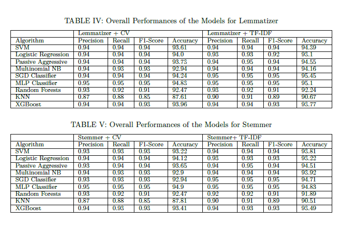
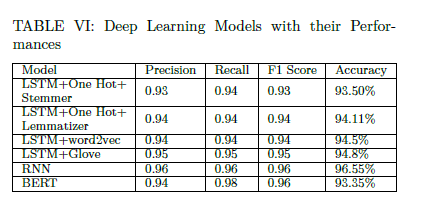
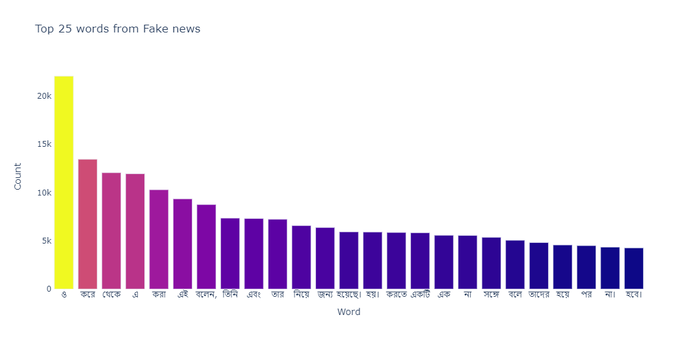

# 📰 Bangla Fake News Detection

> An end-to-end research + application project for detecting fake news in **Bangla (Bengali)** using classical ML, deep learning, and a deployable API + mobile app.

---

## 🚀 Overview

This repository presents a complete pipeline for **Bangla fake news detection**, including:

- 📊 Dataset collection & preprocessing
- 🧠 Model experimentation (ML + DL + BERT)
- 📈 Benchmark evaluation
- 🌐 Flask API for inference
- 📱 Flutter mobile application

---

## 📊 Dataset

- **Total samples:** 11,434
- Includes:
  - Fake news
  - Authentic news
- Files located in: `Dataset/`

### Key Files

- `Fake-1K.csv`
- `LabeledAuthentic-7K.csv`
- `LabeledFake-1K.csv`
- `traindata.csv`, `testdata.csv`, `totaldata.csv`
- `bangla stopwords.txt`

---

## 🧠 Models & Benchmarks

| Model | Accuracy | Notes |
|------|---------|------|
| RNN | **96.55%** | Best performing model |
| TF-IDF + SGD | 95.45% | Strong classical baseline |
| CountVectorizer + MLP | 95.10% | Neural baseline |
| Stemmed CountVec + MLP | 94.9% | Preprocessed variant |
| Bangla BERT | 93.35% | F1 Score: **0.96** |

---

## 🧪 Notebooks

Located in `Notebooks/`

Includes experiments for:

- LSTM
- RNN
- TF-IDF + N-grams
- CountVectorizer
- Bangla BERT

Example notebooks:

- `03_LSTM_for_bangla_fake_news.ipynb`
- `07_bn_fake_news_detection_using_rnn.ipynb`
- `Bangla_Fake_News_BERT.ipynb`
- `Bangla_Fake_News_Model_Evaluation_[TF_IDF].ipynb`

---

## ⚙️ API (Flask)

Located in `API/`

### 🔹 Features

- Cleans Bangla text
- Removes punctuation & digits
- Uses:
  - `tfidf_char.pkl`
  - `model.pkl`
- Returns prediction:
  - `Fake News`
  - `True News`

### 🔹 Run Locally

```bash
cd API
pip install -r requirements.txt
python request.py
```

### 🔹 Example Request

```bash
curl -X POST http://127.0.0.1:4000 \
  -H "Content-Type: application/json" \
  -d '{"data":"বাংলা খবরের টেক্সট এখানে"}'
```

### 🔹 Response

```json
{
  "result": "Fake News"
}
```

---

## 📱 Flutter Mobile App

Located in: `Flutter app code/`

### Features

- Input Bangla news text
- Sends request to API
- Displays result instantly

### Run App

```bash
cd "Flutter app code"
flutter pub get
flutter run
```

---

## 🖼️ Visual Results

### 🔹 Model Performance



### 🔹 Deep Learning Performance



### 🔹 Word Analysis



### 🔹 App Screens

| True News | Fake News |
|----------|----------|
|  |  |

---

## 🏗️ Project Structure

```
Bangla_Feke_News_Detection/
│
├── API/                    # Flask inference API
├── Dataset/                # All datasets
├── Notebooks/              # Model experiments
├── Flutter app code/       # Mobile app
├── Figures/                # Visual outputs
├── Presentations/          # Slides
├── Confusion Matrix/       # Evaluation visuals
├── APK file of APP/        # Built mobile app
```

---

## 🔄 Workflow

1. Dataset collection & preprocessing
2. Feature extraction (TF-IDF / CountVectorizer)
3. Model training (ML + DL + BERT)
4. Evaluation & benchmarking
5. Model serialization
6. API deployment
7. Mobile app integration

---

## ⚠️ Limitations

- Dataset size is relatively small for deep learning
- Domain-specific bias may exist
- Limited real-time deployment scaling

---

## 🔮 Future Improvements

- Larger Bangla dataset
- Transformer fine-tuning improvements
- Better UI/UX in mobile app
- Deploy scalable cloud API

---

## 📌 Citation

If you use this project, please consider citing or giving credit.

---

## 🌐 Repository Link

👉 https://github.com/hasansust32/Bangla_Feke_News_Detection

---

## ✨ Author

**SM Mahamudul Hasan**  
🔗 GitHub: https://github.com/hasansust32

---

## ⭐ If you like this project

Give it a star ⭐ and share it!


