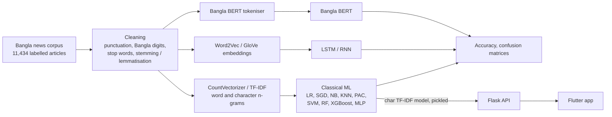

# Bangla Fake News Detection

A benchmark of classical machine learning, deep learning and transformer models for detecting fake news written in Bangla (Bengali), packaged with a Flask inference API and a Flutter mobile client.

This is the code, data and figures behind the IEEE paper **"A Benchmark of Machine Learning and Deep Learning Algorithms for Detecting Fake News in Bangla Language"** ([IEEE Xplore](https://ieeexplore.ieee.org/abstract/document/10103235)), on which I am second author. It started as my undergraduate thesis at Shahjalal University of Science and Technology.

**Why it matters:** Bangla is spoken by more than 200 million people but has far fewer labelled datasets and NLP tools than English. The project compares feature representations and model families on the same Bangla news corpus to show which approaches work in a low-resource setting.

## Results

Reported test accuracy for the strongest configurations (from the paper and the notebooks in [`Notebooks/`](Notebooks)):

| Model | Representation | Accuracy |
|---|---|---:|
| RNN | Word embeddings | **96.55%** |
| SGD classifier | TF-IDF | 95.45% |
| MLP | CountVectorizer | 95.10% |
| MLP | CountVectorizer, stemmed text | 94.90% |
| Bangla BERT | Transformer fine-tuning | 93.35% (F1 0.96) |

The saved notebook outputs confirm the RNN (96.55% test accuracy) and Bangla BERT (93.35%) figures. Results come from a single train/test split; they were not repeated across seeds or folds.


## What's in the project



- **Dataset (`Dataset/`):** 11,434 labelled Bangla articles in `totaldata.csv` (columns `articleID`, `content`, `headline`, `label`), with an 8,004-row training file and a 2,831-row test file, a Bangla stop-word list, and the source fake/authentic/clickbait collections.
- **Experiments (`Notebooks/`):** LSTM and RNN models, Word2Vec and GloVe embeddings, CountVectorizer and TF-IDF with n-grams, character-level TF-IDF, and Bangla BERT fine-tuning.
- **Evaluation (`Confusion Matrix/`, `Figures/`):** confusion matrices for every model on stemmed and lemmatised text, training curves, n-gram and word-frequency analysis.
- **Inference API (`API/`):** a Flask service that cleans the input text, applies the pickled character-level TF-IDF vectoriser (`tfidf_char.pkl`) and classifier (`model.pkl`), and returns a label.
- **Mobile app (`Flutter app code/`, `APK file of APP/`):** a Flutter client that posts text to the API and shows the result.
- **Thesis slides (`Presentations/`).**

## Tech stack

Python · pandas · scikit-learn · XGBoost · TensorFlow/Keras · Bangla BERT (Hugging Face Transformers) · Flask · Flutter/Dart

## Project structure

```text
Bangla_Feke_News_Detection/
├── Dataset/                      # Labelled corpus, train/test splits, stop words
├── Notebooks/                    # Model experiments (LSTM, RNN, TF-IDF, BERT, …)
├── Confusion Matrix/             # Per-model confusion matrices
├── Figures/                      # Performance charts, n-gram analysis, app screenshots
├── API/                          # Flask inference API + pickled model and vectoriser
├── Bangla-Fake-News-API-master/  # Earlier version of the API
├── Flutter app code/             # Mobile client source
├── APK file of APP/              # Built Android APK
└── Presentations/                # Thesis presentations
```

## Running the notebooks

The notebooks were developed in Google Colab. To run them locally:

```bash
git clone https://github.com/hasansust32/Bangla_Feke_News_Detection.git
cd Bangla_Feke_News_Detection
python -m venv .venv && source .venv/bin/activate
pip install jupyter pandas numpy scikit-learn xgboost tensorflow transformers matplotlib seaborn
jupyter notebook Notebooks/
```

Some notebooks reference Google Drive paths; point those at the files in `Dataset/`. There is no pinned environment for the notebooks.

## Running the inference API

```bash
cd API
pip install -r requirements.txt
python request.py          # serves on http://127.0.0.1:4000
```

```bash
curl -X POST http://127.0.0.1:4000/ \
  -H "Content-Type: application/json" \
  -d '{"data": "বাংলা খবরের টেক্সট এখানে"}'
```

```json
{ "result": "Fake News" }
```

The only endpoint is `POST /` with a JSON body `{"data": "<text>"}`; it returns `"Fake News"` or `"True News"`. There is no authentication or input validation.

> `API/requirements.txt` pins 2021-era versions (Flask 1.1.2, scikit-learn 0.24.2, NumPy 1.19.5). The pickled model must be loaded with the same scikit-learn version, which in practice means Python 3.8 or 3.9. I have not re-verified the API on a current Python version.

## Running the mobile app

```bash
cd "Flutter app code"
flutter pub get
flutter run
```

The app posts to a hard-coded Heroku URL in `lib/main.dart` that is no longer live. To try it, run the API locally and change that URL to your machine's address and port 4000.

## Limitations

- Single train/test split; no cross-validation or confidence intervals.
- The corpus comes from a limited set of news sources and periods, so the models may learn source or topic cues rather than veracity.
- The deployed API uses the character-level TF-IDF classical model, not the best-scoring RNN.
- The API reloads both pickles on every request and has no logging, validation or tests.

## Credits

Research carried out with my co-authors at HAB Lab, SUST (see the paper for the full author list). The Flask API code was written by teammate **nirzak** (author header in `API/request.py`).

## Author

**S M Mahamudul Hasan** · [GitHub](https://github.com/hasansust32) · [Portfolio](https://www.hasansm.com/) · [LinkedIn](https://www.linkedin.com/in/sm-mahamudul-hasan/)
